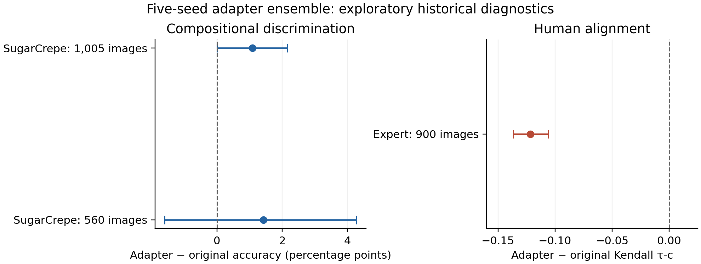

# Báo cáo Stage8: metric mở rộng và adapter học trên EmbeddingGemma-2

Ngày: 09/10/2026. Đây là phần bổ sung cho báo cáo/source Stage1–7, được giữ nguyên trong `baseline.zip` của gói đầy đủ.

## Kết quả chính

Đã xác thực Kaggle API, tạo dataset và notebook riêng tư, tính thêm 11 thống kê đánh giá, 7 baseline tham chiếu và huấn luyện 20 adapter residual. Ensemble 5 seed tăng accuracy phân biệt caption trên SugarCrepe, nhưng giảm mạnh mức tương hợp với đánh giá con người trên Flickr8kExpert. Phương pháp hiện tại thể hiện trade-off; bằng chứng chưa hỗ trợ kết luận cải tiến tổng thể.

| Phép đo | Gemma gốc | Gemma + ensemble adapter |
|---|---:|---:|
| Accuracy SugarCrepe 560 ảnh/cặp | 89.8214% | 91.2500% |
| Accuracy SugarCrepe 1.005 ảnh / 3.949 cặp | 91.5675% | 92.6564% |
| Kendall τ-c, 900 ảnh expert | 0.544936 | 0.423398 |
| Pair accuracy trong ảnh expert | 80.9494% | 73.2847% |
| NDCG@5, expert | 0.891922 | 0.845250 |

Khoảng tin cậy dưới đây là bootstrap ghép cặp theo ảnh, mang tính thăm dò trên benchmark đã được quan sát; không điều chỉnh nhiều phép so sánh và không tạo ra một test xác nhận mới.

- historical560: Δ accuracy = +1.4286 điểm phần trăm; CI95% [-1.6071, 4.2857], 5.000 bootstrap. Gemma gốc đúng/adapter sai: 32; chiều ngược lại: 40.
- historical_unseen3949: Δ accuracy = +1.0889 điểm phần trăm; CI95% [0.0000, 2.1653], 5.000 bootstrap. Gemma gốc đúng/adapter sai: 202; chiều ngược lại: 245.
- Expert 900: Δ τ-c = -0.121538; CI95% [-0.136434, -0.105794], 1.000 bootstrap.

560 ảnh nằm trong nhóm 1.005 ảnh lịch sử chưa dùng ở development; hai số mẫu không được cộng lại. Các benchmark này cùng nhãn/kết quả đã được nghiên cứu ở các stage trước.

Hình: Δ ensemble − Gemma gốc; thanh ngang là CI95% bootstrap ghép cặp theo ảnh. Đây là chẩn đoán thăm dò trên benchmark lịch sử.

## Dữ liệu và quy trình huấn luyện

Backbone: `google/embeddinggemma-2`, revision `914f7f89142e33e77833254d9c9b90c3cef7303b`, embedding 768 chiều, float32, prefix `A photo depicts `. Trọng số encoder giữ cố định. Hai residual projection riêng cho ảnh và text có dạng normalize(x + U·D·x), khởi tạo U=0 để bắt đầu đúng tại embedding gốc. Trọng số của adapter được cập nhật bằng gradient.

Train chỉ dùng 555 ảnh SugarCrepe thuộc development lịch sử: 444 train / 111 validation, chia theo ảnh với seed 20261009. Kiểm tra cả tên ảnh và SHA256 byte ảnh xác nhận train/validation/historical test không trùng nhau; train/validation không trùng hash ảnh expert. Train và chọn checkpoint chỉ forward các embedding development.

Số cặp: 2816 train và 746 validation. Grid cố định: rank 16/32 × anchor 0,1/1,0 × seed 11/23/37/53/71 = 20 lần train, mỗi lần 30 epoch. AdamW: lr 0,001, weight decay 0,0001, batch 128, gradient clip 1. Loss = softplus((s_neg − s_pos + 0,02)/0,05) + λ·mean(1 − cosine(embedding mới, embedding gốc)).

Mỗi checkpoint được chọn bằng accuracy macro theo ảnh của validation, ưu tiên epoch sớm khi hòa. Rank/anchor được chọn bằng trung bình validation của 5 seed; hòa thì ưu tiên rank nhỏ và anchor mạnh. Điểm trên SugarCrepe historical test hoặc Flickr8kExpert không tham gia lựa chọn.

Cấu hình chọn: rank 32, anchor 1.0, validation trung bình 0.951076. Mỗi adapter có 98,304 tham số; ensemble sử dụng cả 5 seed và trung bình score sau clamp. Đây là thích nghi ở đầu ra encoder; LoRA/full fine-tuning backbone là một bước nghiên cứu riêng.

| Seed | Epoch chọn | Validation macro accuracy | Expert τ-c |
|---|---:|---:|---:|
| 11 | 1 | 0.963140 | 0.448730 |
| 23 | 1 | 0.941067 | 0.440034 |
| 37 | 1 | 0.966783 | 0.475759 |
| 53 | 3 | 0.942369 | 0.387745 |
| 71 | 3 | 0.942021 | 0.347573 |

## Metric mở rộng

Bảng dữ liệu đầy đủ `stage8/results/all_metrics.csv` và JSON chứa cả cohort 1.000 ảnh và 900 ảnh expert. Cohort 900 có 5.112 candidate, 15.336 rating cá nhân, 9.459 cặp có mean rating khác nhau. Có 46 tên cột score trước PAC-S: 32 cấu hình baseline đã có, một score gốc tái tính để kiểm tra, 5 adapter, 1 ensemble, 7 metric tham chiếu. Các biến thể chiều/prompt/precision không phải backbone độc lập.

| Metric, expert 900 | Gemma gốc | Adapter ensemble |
|---|---:|---:|
| Kendall τ-c, rating cá nhân | 0.544936 | 0.423398 |
| Kendall τ-b, rating cá nhân | 0.541571 | 0.420784 |
| Spearman, rating cá nhân | 0.660738 | 0.521346 |
| Pearson, rating cá nhân | 0.708082 | 0.576396 |
| Spearman, mean rating | 0.740242 | 0.576368 |
| Pair accuracy micro trong ảnh | 0.809494 | 0.732847 |
| Pair accuracy macro theo ảnh | 0.823583 | 0.747539 |
| NDCG@5 | 0.891922 | 0.845250 |
| Top1 đúng caption human-best | 0.682682 | 0.601117 |
| AUROC, mean rating ≥3 | 0.960525 | 0.924352 |
| Average precision, mean rating ≥3 | 0.737912 | 0.649310 |

PAC-S đã chạy thành công, nâng bảng tổng hợp lên 47 tên cột score. Trên expert 900, PAC-S τ-c = 0.539870, pair accuracy = 81.1819%. Δ τ-c (PAC-S − Gemma gốc) = -0.005066, CI95% [-0.012834, 0.003265] từ 1.000 bootstrap theo ảnh. CI chứa 0; điểm ước lượng này chưa chứng minh ưu thế về human alignment của một trong hai metric.

Kendall/Spearman/Pearson cá nhân lặp score caption theo từng rating; mỗi caption có ba rating. Pair accuracy bỏ cặp hòa mean rating, score hòa được tính chưa xếp đúng. Macro lấy trung bình accuracy của từng ảnh. NDCG dùng gain 2^(mean rating−1)−1, k=5, kỳ vọng DCG khi score hòa; chỉ tính nhóm ≥2 candidate có ideal gain dương. Top1 lấy tỷ lệ caption tốt nhất theo người trong nhóm score đứng đầu bị hòa. AUROC và average precision dùng positive mean rating ≥3; AP là average precision, không phải tích phân hình thang PR-AUC. Các score không được diễn giải thành xác suất đã calibration.

## Baseline dùng reference

Đã chạy pycocoevalcap 1.2 với COCO PTBTokenizer và 5 reference `ground_truth` nguyên bản từ annotation tác giả; không tạo reference bằng LLM. CIDEr dùng IDF chuẩn trên corpus candidate-record, trong đó reference được lặp cho các candidate khác nhau của cùng ảnh. BLEU là sentence score cho từng candidate. Java PTBTokenizer/METEOR đã thực thi thành công.

| Method | Expert 900 Kendall τ-c |
|---|---:|
| BLEU1 | 0.318847 |
| BLEU2 | 0.322758 |
| BLEU3 | 0.313120 |
| BLEU4 | 0.305840 |
| ROUGE_L | 0.319805 |
| CIDEr | 0.436426 |
| METEOR | 0.417196 |

Các baseline này nhận thêm reference, khác điều kiện đầu vào của Gemma/SigLIP/CLIP reference-free. SPICE là tùy chọn cần Java assets, chưa chạy; không có giá trị SPICE giả hoặc thay bằng metric khác.

## Kaggle và phép đo GPU

Kaggle account: `dungdq210`. Dataset riêng tư: `dungdq210/embeddinggemma-stage8-20261009-cc802fcc`. Notebook riêng tư: [dungdq210/embeddinggemma-stage8-20261009](https://www.kaggle.com/code/dungdq210/embeddinggemma-stage8-20261009). Quota lúc xác thực: GPU 30h / TPU 20h còn lại; đây là snapshot trước job, không phải số dư thời gian thực.

Trạng thái mới nhất đã xác minh: **COMPLETE**, kernel version 2. Hoàn thành remote: True.

GPU: Tesla T4; Torch 2.11.0+cu128; float32, TF32 disabled.

| Model | Batch | P50 ms/batch | P95 ms/batch | Pairs/s | Peak allocated MiB |
|---|---:|---:|---:|---:|---:|
| gemma | 1 | 482.861 | 489.743 | 2.07 | 1842.3 |
| gemma | 8 | 3590.253 | 3730.966 | 2.23 | 2779.3 |
| gemma-adapter-ensemble5 | 1 | 491.520 | 502.057 | 2.03 | 1844.2 |
| gemma-adapter-ensemble5 | 8 | 3569.635 | 3620.479 | 2.24 | 2781.2 |
| siglip224 | 1 | 45.645 | 51.310 | 21.91 | 1471.7 |
| siglip224 | 8 | 138.259 | 141.754 | 57.86 | 1524.0 |
| clip-B32 | 1 | 74.806 | 128.944 | 13.37 | 613.1 |
| clip-B32 | 8 | 75.521 | 135.875 | 105.93 | 636.9 |

Adapter được train lại trên GPU để tái lập. Cấu hình và epoch được chọn trùng CPU; sai khác human score lớn nhất giữa CPU/GPU = 4.29e-06. Bảng human/accuracy chính dùng kết quả CPU; phép đo fresh GPU dùng checkpoint train trên GPU, không tuyên bố checkpoint byte-identical. 92 file output đã khớp SHA256 manifest phiên chạy; runtime và manifest được tải riêng.

Ở batch 1 trong cấu hình phục vụ native đã đo, Gemma gốc khoảng 482.86 ms/cặp, SigLIP2-224 khoảng 45.65 ms/cặp; Gemma chậm hơn khoảng 10.6 lần trong phép đo này. Ensemble adapter khoảng 491.52 ms/cặp. Kết quả này không hỗ trợ claim Gemma là encoder nhanh hơn; giới hạn phần cứng/precision/native preprocessing/8 input phải đi cùng mọi trích dẫn latency.

Protocol GPU: cùng một phiên GPU0, float32, TF32 tắt; cùng 8 ảnh/caption expert thật, batch 1 và 8; warmup 3, đo 15 lần với CUDA synchronize; lưu mọi sample, p50/p95, throughput, peak allocated/reserved. Thời gian bao gồm decode/preprocessing native, encoding ảnh + text, scoring và adapter khi có; download/load model được loại khỏi phép đo. Image budget native khác nhau giữa encoder. Trọng số được pin revision và ghi SHA256. Chi phí lưu embedding int8 trước đây là storage payload, không phải tốc độ encoder.

PAC-S dùng repo tác giả pin `bfbc488e9f5cccd818e75c7cdfaa37e1c87f00eb`, checkpoint PAC-S ViT-B/32 đúng của tác giả, w=2.0; SHA checkpoint được ghi sau download, tác giả chưa cung cấp hash đã xác minh trong quy trình này. Trạng thái PAC-S riêng trong output, không thay bằng PAC-S++. Overlap pretraining của các backbone và fine-tuning PAC-S với expert chưa được audit độc lập; audit ảnh/hash ở trên xác minh dữ liệu huấn luyện adapter.

## Kiểm tra và khả năng tái lập

- 32 endpoint Kendall τ-c cũ được tái lập với sai số <1e−12.
- Kiểm tra identity của adapter khởi tạo, gradient học khác zero, checkpoint NPZ roundtrip, NDCG score ties đối chiếu sklearn, top1/pair khi hòa, tách ảnh/hash và parse toàn bộ Python đều pass.
- Đã kiểm tra token không xuất hiện trong snapshot source notebook. Credential được truyền riêng vào controller, không chứa trong notebook/report/gói source.
- Mọi run lưu history, checkpoint hash, số tham số và validation score. Snapshot source của từng phiên Kaggle được giữ riêng với log thành công/lỗi.

Protocol SHA256: `cc802fcccba757e8fe2f0bb3f619b8d2c0fe1ea8fb60b363c3ac772eedbfb54b`. Gói đầy đủ giữ các manifest/vector/score/checkpoint Stage1–7 trong `baseline.zip`; Stage8 ghi các file mới tách riêng. Các log lần chạy không thành công cũng được giữ để có thể kiểm tra.

## Ý nghĩa đối với paper và bước tiếp theo

Phần mở rộng đủ để viết mục ablation/adaptation và đánh giá đa metric với kết quả âm minh bạch. Hiện chưa có bằng chứng cho claim một Gemma thích nghi cải thiện đồng thời compositional discrimination và human alignment; CI SugarCrepe 560 chứa 0, còn mức giảm expert lớn và nhất quán qua seed. Loss hard-negative chỉ từ SugarCrepe là một giả thuyết giải thích trade-off, chưa được kiểm chứng bằng ablation nhân quả.

Nếu mục tiêu paper là phương pháp thích nghi có khả năng tổng quát, cần thiết kế tiếp mục tiêu giữ human alignment hoặc huấn luyện đa nhiệm, chọn bằng validation thích hợp, rồi khóa phương pháp và đánh giá một bộ test mới độc lập có audit overlap. Cấu trúc adapter/loss hiện tại dùng thành phần phổ biến; chưa thực hiện đánh giá novelty đầy đủ hoặc đảm bảo điều kiện chấp nhận của venue.

## Nguồn chính

- Kaggle CLI: https://github.com/Kaggle/kaggle-cli
- PAC-S, implementation tác giả: https://github.com/aimagelab/pacscore
- COCO caption metrics: https://github.com/salaniz/pycocoevalcap
- Flickr8k-HumanEval mirror pin theo manifest: https://huggingface.co/datasets/yuwd/Flickr8k-HumanEval
- EmbeddingGemma-2: https://huggingface.co/google/embeddinggemma-2

Chi tiết nguồn, phiên bản và SHA256 của baseline nằm trong các receipt/manifest Stage1–7; điều khoản dữ liệu và trọng số tiếp tục thuộc nguồn gốc.
