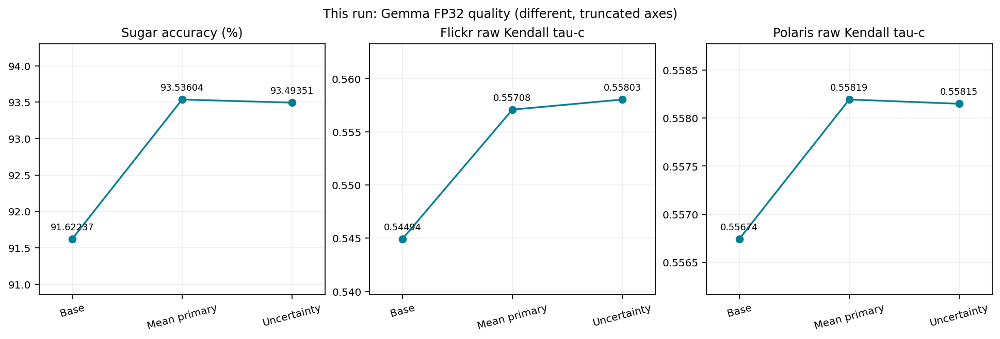
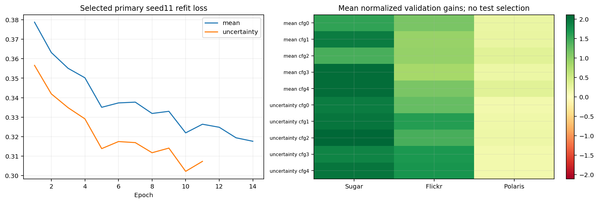
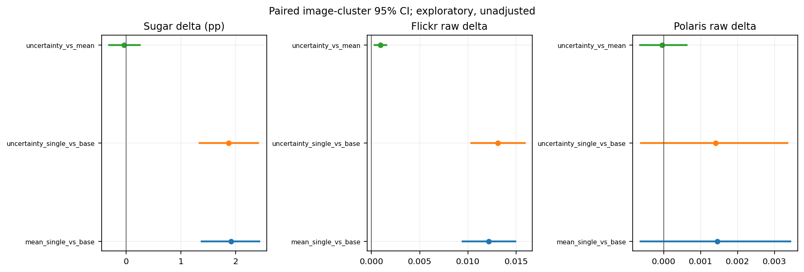
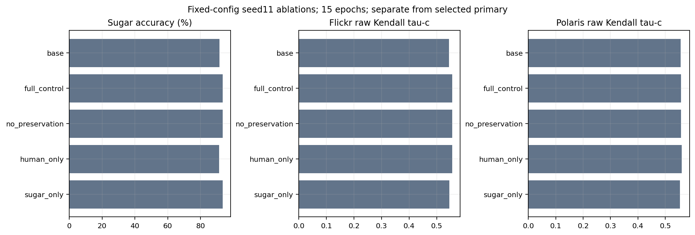
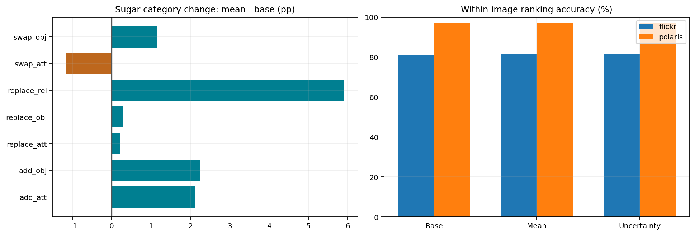
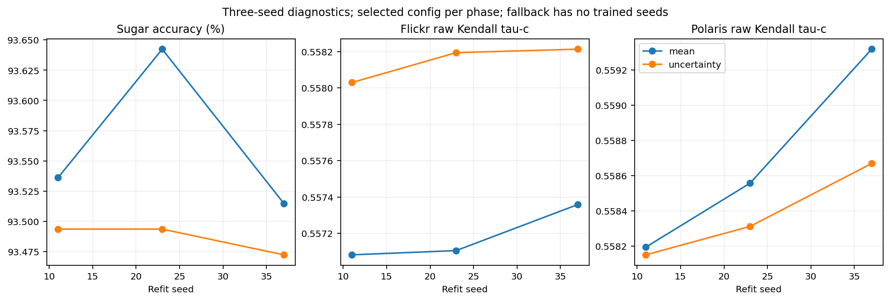
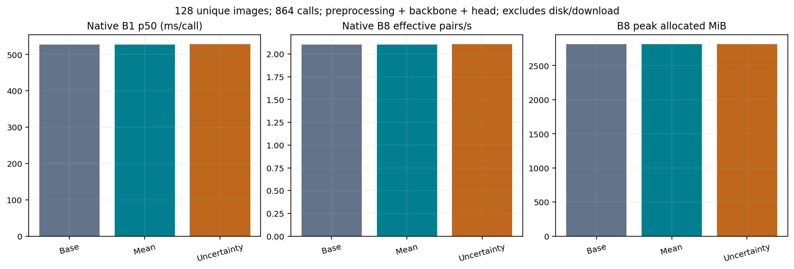
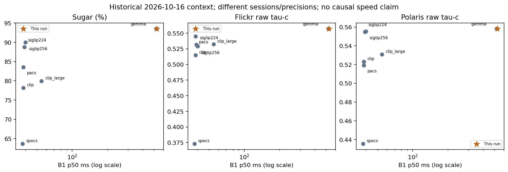

# Báo cáo Gemma — end to end
Nguồn dữ liệu: `new_native_gpu_run`. Tạo lúc 2026-10-17T04:28:07.364436+00:00.

## 1. Phạm vi và kết luận từ lần chạy này

Nguồn: new_native_gpu_run. Báo cáo được dựng từ predictions, selection, CI và timing của đúng producer có SHA bên dưới; không đọc metric cũ để điền kết quả mới. Primary cố định là mean_single, seed11.

sugar_accuracy: mean − base = +1.913672, CI95 [+1.380610, +2.429693] (điểm phần trăm); CI nằm trên 0.

flickr_raw_vote_tau_c: mean − base = +0.012146, CI95 [+0.009446, +0.014905] (tau-c); CI nằm trên 0.

polaris_raw_vote_tau_c: mean − base = +0.001450, CI95 [-0.000628, +0.003424] (tau-c); CI chứa 0; chưa đủ bằng chứng về dấu của cải thiện.

| variant | sugar_accuracy_pct | flickr_raw_tau_c | polaris_raw_tau_c | adapter_parameters |
| --- | --- | --- | --- | --- |
| base | 91.622369 | 0.544936 | 0.556743 | 0 |
| mean_single | 93.536041 | 0.557082 | 0.558193 | 49152 |
| uncertainty_single | 93.493515 | 0.558029 | 0.558149 | 49152 |

## 2. Idea và phương pháp

Backbone google/embeddinggemma-2 frozen, FP32; embedding chuẩn hóa 768 chiều. Dùng chung residual adapter cho ảnh và text: r = W_up tanh(W_down x); b = r / max(1, ||r||₂); A(x) = normalize(x + radius × b). W_up khởi tạo 0; không bias. Score = 2.5 × max(0, cosine(Au, Av)), không phải xác suất. Prefix text giữ nguyên “A photo depicts ”, gồm khoảng trắng cuối.

Loss pairwise softplus((margin − positive_cos + negative_cos)/0.05), Sugar margin 0.02, human margin 0. Hai nhánh dùng equal domain budgets và preservation embedding/score. Mean dùng trung bình votes để xếp cặp trong cùng ảnh. Uncertainty nhân trọng số gap/(gap + SE_pos + SE_neg + 1e-6), singleton SE=0 là heuristic. AdamW lr=0.001, weight_decay=0.0001, batch=128, tối đa 15 epochs.

Chọn config/epoch chỉ trên validation qua ba seed. Gain chuẩn hóa [0.01, 0.02, 0.02]; yêu cầu không âm ở cả ba domain, tối đa hóa gain yếu nhất; nếu không có config hợp lệ thì fallback base. Refit train+validation bằng median epoch. Test không dùng chọn config, seed hay primary.

## 3. Dữ liệu, split và kiểm tra toàn vẹn

Tổng 22642 records; 18537 test records. Overlap ảnh giữa các split: {'train_validation': 0, 'train_test': 0, 'validation_test': 0}. Sugar: strict greater, ties tính sai. Human: Kendall tau-c trên individual votes, caption mean và within-image ranking tách riêng. Không dùng reference caption khi tính score.

| domain | split | records | images | votes |
| --- | --- | --- | --- | --- |
| sugar | train | 2271 | 444 | 0 |
| sugar | validation | 537 | 111 | 0 |
| sugar | test | 4703 | 1005 | 0 |
| flickr | train | 442 | 80 | 1326 |
| flickr | validation | 110 | 20 | 330 |
| flickr | test | 5112 | 900 | 15336 |
| polaris | train | 619 | 500 | 763 |
| polaris | validation | 126 | 100 | 158 |
| polaris | test | 8722 | 2737 | 26098 |

## 4. Validation và quá trình học

{
  "mean": {
    "fallback_base": false,
    "config": {
      "rank": 32,
      "radius": 0.03,
      "preservation": 0.1
    },
    "epochs": 14,
    "mean_normalized_gain": [
      1.427684667908128,
      0.9427609427609415,
      0.3138909884941606
    ]
  },
  "uncertainty": {
    "fallback_base": false,
    "config": {
      "rank": 32,
      "radius": 0.03,
      "preservation": 0.1
    },
    "epochs": 11,
    "mean_normalized_gain": [
      2.110490378646801,
      1.432506887052341,
      0.18196579043139685
    ]
  }
}

| phase | config_index | rank | radius | preservation | gain_sugar | gain_flickr | gain_polaris | eligible | best_epochs |
| --- | --- | --- | --- | --- | --- | --- | --- | --- | --- |
| mean | 0 | 16 | 0.030000 | 0.100000 | 1.551831 | 1.126416 | 0.218359 | True | [7, 7, 10] |
| mean | 1 | 16 | 0.100000 | 0.100000 | 1.924271 | 0.936639 | 0.232006 | True | [5, 10, 8] |
| mean | 2 | 32 | 0.030000 | 0.100000 | 1.427685 | 0.942761 | 0.313891 | True | [15, 6, 14] |
| mean | 3 | 32 | 0.100000 | 0.100000 | 2.048417 | 0.826446 | 0.209261 | True | [4, 5, 5] |
| mean | 4 | 32 | 0.100000 | 0.010000 | 2.048417 | 1.132537 | 0.313891 | True | [4, 5, 2] |
| uncertainty | 0 | 16 | 0.030000 | 0.100000 | 1.924271 | 1.261096 | 0.141023 | True | [7, 15, 8] |
| uncertainty | 1 | 16 | 0.100000 | 0.100000 | 1.986344 | 1.616162 | 0.177417 | True | [4, 3, 2] |
| uncertainty | 2 | 32 | 0.030000 | 0.100000 | 2.110490 | 1.432507 | 0.181966 | True | [4, 14, 11] |
| uncertainty | 3 | 32 | 0.100000 | 0.100000 | 1.862197 | 1.677380 | 0.141023 | True | [4, 1, 2] |
| uncertainty | 4 | 32 | 0.100000 | 0.010000 | 1.986344 | 1.707989 | 0.141023 | True | [4, 1, 2] |

## 5. Khoảng tin cậy paired và so sánh uncertainty

Paired image-cluster bootstrap, 2000 resamples; giữ các caption/vote của mỗi ảnh. Các CI chưa điều chỉnh nhiều phép thử và không bao gồm toàn bộ biến thiên do training. CI point estimates được đối chiếu lại với metrics; report không chạy bootstrap chất lượng mới. Uncertainty có config/epoch được chọn riêng nên chênh lệch hai phase không cô lập nhân quả của weighting.

| contrast | metric | delta | lower95 | upper95 | unit | replicates |
| --- | --- | --- | --- | --- | --- | --- |
| mean_single_vs_base | sugar_accuracy | 0.019137 | 0.013806 | 0.024297 | fraction | 2000 |
| mean_single_vs_base | flickr_caption_mean_tau_c | 0.017122 | 0.013492 | 0.020936 | correlation | 2000 |
| mean_single_vs_base | flickr_raw_vote_tau_c | 0.012146 | 0.009446 | 0.014905 | correlation | 2000 |
| mean_single_vs_base | polaris_caption_mean_tau_c | 0.000747 | -0.000007 | 0.001469 | correlation | 2000 |
| mean_single_vs_base | polaris_raw_vote_tau_c | 0.001450 | -0.000628 | 0.003424 | correlation | 2000 |
| uncertainty_single_vs_base | sugar_accuracy | 0.018711 | 0.013399 | 0.024127 | fraction | 2000 |
| uncertainty_single_vs_base | flickr_caption_mean_tau_c | 0.018341 | 0.014615 | 0.022119 | correlation | 2000 |
| uncertainty_single_vs_base | flickr_raw_vote_tau_c | 0.013093 | 0.010335 | 0.015869 | correlation | 2000 |
| uncertainty_single_vs_base | polaris_caption_mean_tau_c | 0.000825 | 0.000102 | 0.001534 | correlation | 2000 |
| uncertainty_single_vs_base | polaris_raw_vote_tau_c | 0.001406 | -0.000608 | 0.003353 | correlation | 2000 |
| uncertainty_vs_mean | sugar_accuracy | -0.000425 | -0.003174 | 0.002456 | fraction | 2000 |
| uncertainty_vs_mean | flickr_caption_mean_tau_c | 0.001218 | 0.000357 | 0.002053 | correlation | 2000 |
| uncertainty_vs_mean | flickr_raw_vote_tau_c | 0.000947 | 0.000324 | 0.001538 | correlation | 2000 |
| uncertainty_vs_mean | polaris_caption_mean_tau_c | 0.000078 | -0.000136 | 0.000314 | correlation | 2000 |
| uncertainty_vs_mean | polaris_raw_vote_tau_c | -0.000044 | -0.000639 | 0.000624 | correlation | 2000 |

## 6. Ablation

Các ablation dùng rank32/radius0.03/preservation0.1 (trừ no_preservation), seed11, 15 epochs. Đây là control cố định, không đồng nhất với số epoch của primary đã chọn. Giữ mọi kết quả âm.

| variant | sugar_accuracy_pct | flickr_raw_tau_c | polaris_raw_tau_c |
| --- | --- | --- | --- |
| ablation_sugar_only | 93.578567 | 0.546170 | 0.553497 |
| ablation_human_only | 91.431001 | 0.556451 | 0.560497 |
| ablation_no_preservation | 93.642356 | 0.556814 | 0.557770 |
| ablation_full_control | 93.578567 | 0.556860 | 0.558097 |
| base | 91.622369 | 0.544936 | 0.556743 |

## 7. Phân tích lỗi và metric theo domain

Bảng dưới đếm cặp Sugar được sửa và cặp đang đúng bị làm sai, ghép trên cùng record. sugar_changed_pairs.csv chứa toàn bộ thay đổi với caption và margin. Global raw tau-c và within-image ranking đo hai khía cạnh khác nhau; một metric tăng không bảo đảm metric kia tăng.

| variant | category | pairs | base_accuracy_pct | accuracy_pct | delta_pp | fixed | regressed | net_fixed |
| --- | --- | --- | --- | --- | --- | --- | --- | --- |
| mean_single | add_att | 424 | 91.509434 | 93.632075 | 2.122642 | 11 | 2 | 9 |
| mean_single | add_obj | 1296 | 95.524691 | 97.762346 | 2.237654 | 31 | 2 | 29 |
| mean_single | replace_att | 488 | 93.852459 | 94.057377 | 0.204918 | 6 | 5 | 1 |
| mean_single | replace_obj | 1023 | 97.751711 | 98.044966 | 0.293255 | 7 | 4 | 3 |
| mean_single | replace_rel | 864 | 83.101852 | 89.004630 | 5.902778 | 57 | 6 | 51 |
| mean_single | swap_att | 435 | 86.436782 | 85.287356 | -1.149425 | 7 | 12 | -5 |
| mean_single | swap_obj | 173 | 75.722543 | 76.878613 | 1.156069 | 5 | 3 | 2 |
| uncertainty_single | add_att | 424 | 91.509434 | 93.632075 | 2.122642 | 11 | 2 | 9 |
| uncertainty_single | add_obj | 1296 | 95.524691 | 97.453704 | 1.929012 | 28 | 3 | 25 |
| uncertainty_single | replace_att | 488 | 93.852459 | 94.262295 | 0.409836 | 7 | 5 | 2 |
| uncertainty_single | replace_obj | 1023 | 97.751711 | 97.849462 | 0.097752 | 6 | 5 | 1 |
| uncertainty_single | replace_rel | 864 | 83.101852 | 88.888889 | 5.787037 | 57 | 7 | 50 |
| uncertainty_single | swap_att | 435 | 86.436782 | 85.747126 | -0.689655 | 9 | 12 | -3 |
| uncertainty_single | swap_obj | 173 | 75.722543 | 78.034682 | 2.312139 | 6 | 2 | 4 |

## 8. Dao động theo seed

Tất cả seed refit của lần chạy này được giữ, không chọn seed có test tốt nhất. Ba seed là diagnostics; không coi phạm vi giữa seed là confidence interval. Các control CPU năm seed của nghiên cứu trước không được gọi là kết quả mới.

| phase | seed | sugar_accuracy_pct | flickr_raw_tau_c | polaris_raw_tau_c |
| --- | --- | --- | --- | --- |
| mean | 11 | 93.536041 | 0.557082 | 0.558193 |
| mean | 23 | 93.642356 | 0.557106 | 0.558557 |
| mean | 37 | 93.514778 | 0.557358 | 0.559319 |
| uncertainty | 11 | 93.493515 | 0.558029 | 0.558149 |
| uncertainty | 23 | 93.493515 | 0.558194 | 0.558311 |
| uncertainty | 37 | 93.472252 | 0.558213 | 0.558669 |

## 9. Trade-off chất lượng, latency và bộ nhớ

GPU Tesla T4, dtype torch.float32. B1 mean overhead paired median +0.7859 ms/call; CI95 [+0.4098, +1.0285]. CI timing resample input groups, giữ cả hai rounds. Throughput effective = batch × 1000 / median(ms/call), khác aggregate throughput. Peak là allocated memory, không phải toàn bộ VRAM/reserved memory. Mẫu 128 ảnh gồm 43 Sugar/43 Flickr/42 Polaris, 864 calls; gồm preprocessing, encoder, normalize, head, score; loại disk IO/model download. Cached-head latency báo riêng, không dùng làm native latency.

| variant | adapter_parameters | adapter_fp32_kib | b1_p50_ms_call | b1_p95_ms_call | b8_effective_throughput_pairs_s | b8_peak_allocated_mib |
| --- | --- | --- | --- | --- | --- | --- |
| base | 0 | 0.000000 | 527.148535 | 533.187986 | 2.104490 | 2811.698242 |
| mean_single | 49152 | 192.000000 | 527.902881 | 534.858588 | 2.104392 | 2811.698242 |
| uncertainty_single | 49152 | 192.000000 | 528.034076 | 536.362403 | 2.105975 | 2811.698242 |

## 10. Ngữ cảnh so sánh bảy backbone đã có

Đây là số liệu lưu từ nghiên cứu Stage12 ngày 16/10/2026; các model khác không được train/đo lại trong notebook Gemma. Gemma FP32, các recipe khác FP16; session khác nhau. Đồ thị chỉ là ngữ cảnh chất lượng/chi phí, không chứng minh hiệu ứng nhân quả kiến trúc hay speedup cùng precision. Bảng historical_seven_backbones.csv giữ revision, device ; dataset fingerprints are retained privately.

| backbone | precision | gpu | sugar_accuracy_pct_up | flickr_raw_tau_c_up | polaris_raw_tau_c_up | representative_b1_p50_ms | representative_b8_effective_pairs_s | representative_peak_mib |
| --- | --- | --- | --- | --- | --- | --- | --- | --- |
| gemma | torch.float32 | Tesla T4 | 93.53604082500532 | 0.5570821436148593 | 0.5581930507798317 | 522.6181989999645 | 2.1298305742141577 | 2779.6982421875 |
| clip | torch.float16 | Tesla T4 | 78.16287476079098 | 0.5147023828474819 | 0.5229680763278524 | 38.30018250005196 | 146.43246002751974 | 340.837890625 |
| siglip224 | torch.float16 | Tesla T4 | 88.77312353816713 | 0.5314270149837632 | 0.5549024927711503 | 39.00653849996161 | 146.8974577521798 | 795.4150390625 |
| clip_large | torch.float16 | Tesla T4 | 79.97023176695726 | 0.532397883310217 | 0.5309432346118238 | 54.73415350002142 | 65.90030678189713 | 956.9072265625 |
| siglip256 | torch.float16 | Tesla T4 | 89.98511588347863 | 0.5289951274718774 | 0.5553527827088617 | 39.895497500083366 | 140.59578641974855 | 835.3310546875 |
| specs | torch.float16 | Tesla T4 | 63.6402296406549 | 0.3729622740532662 | 0.43544471042114635 | 37.61968649996561 | 113.02086149647408 | 392.38427734375 |
| pacs | torch.float16 | Tesla T4 | 83.58494577928981 | 0.5449469811650547 | 0.5192427546081385 | 38.31470700015416 | 118.5243622088464 | 371.47705078125 |

## 10b. Control năm seed đã hoàn tất trước đó (lịch sử)

Control CPU gốc: cùng rank32/radius0.03/preservation0.1, cùng 14 epochs và paired initialization/batches cho hai loss, năm seed11/23/37/53/71. Bảng này được copy và kiểm SHA, không được train lại trong notebook GPU. Chỉ so CPU với CPU; không dùng khác biệt CPU/CUDA để quy cho weighting. Mean vẫn là primary. historical_multiseed_per_seed.csv giữ từng seed; CI seed-only không thay CI seed×image.

| metric | mean_value | uncertainty_value | delta | unit | positive_seeds | negative_seeds | seeds | crossed_lower95 | crossed_upper95 |
| --- | --- | --- | --- | --- | --- | --- | --- | --- | --- |
| sugar_accuracy | 93.60408250053156 | 93.5020199872422 | -0.10206251328938931 | pp | 1 | 4 | 5 | -0.32824705939063376 | 0.1172917094169937 |
| flickr_raw_vote_tau_c | 0.5575952294069291 | 0.5570339811624242 | -0.000561248244504764 | tau-c | 0 | 5 | 5 |  |  |
| flickr_caption_mean_tau_c | 0.5931680861653236 | 0.5922043665808682 | -0.000963719584455447 | tau-c | 0 | 5 | 5 |  |  |
| flickr_caption_ranking_accuracy | 81.6957395073475 | 81.62807907812665 | -0.06766042922084603 | pp | 0 | 5 | 5 | -0.21280122716691757 | 0.08871475295888091 |
| polaris_raw_vote_tau_c | 0.558604798236251 | 0.5577662344413774 | -0.0008385637948737035 | tau-c | 0 | 5 | 5 |  |  |
| polaris_caption_mean_tau_c | 0.5110165266741505 | 0.5108261472484535 | -0.00019037942569710697 | tau-c | 0 | 5 | 5 |  |  |
| polaris_caption_ranking_accuracy | 97.06319702602231 | 97.11466971690021 | 0.05147269087789397 | pp | 4 | 0 | 5 | -0.02796715065709994 | 0.13552432656293287 |

## 10c. CI seed × image cho control lịch sử

Bootstrap crossed đồng thời seed và image cluster, giữ paired predictions và toàn bộ votes. Flickr/Polaris raw weighting effect âm trong control lịch sử này; không suy thành uncertainty luôn có hại ở mọi corpus. Sugar crossed CI nằm ở bảng aggregate trên.

| domain | metric | delta | lower95 | upper95 | replicates | training_seeds |
| --- | --- | --- | --- | --- | --- | --- |
| flickr | caption_mean_tau_c | -0.000963719584455447 | -0.001748480563883631 | -0.000220493953074214 | 2000 | 5 |
| flickr | raw_vote_tau_c | -0.000561248244504764 | -0.0010768048047883234 | -6.687920056869259e-05 | 2000 | 5 |
| polaris | caption_mean_tau_c | -0.00019037942569710697 | -0.0004004416644858261 | 2.5445772069880225e-05 | 2000 | 5 |
| polaris | raw_vote_tau_c | -0.0008385637948737035 | -0.001410111389772551 | -0.0002464733441771279 | 2000 | 5 |

## 11. Giới hạn và hướng tiếp theo

Đây là continuation exploratory trên corpus đã quan sát, không fresh holdout/SOTA hoặc phục hồi exact Stage9/10. Chưa có audit độc lập về overlap với pretraining. Không diễn giải CI chứa 0 thành bằng nhau; không gọi uncertainty tốt hơn chỉ vì một point estimate cao. Không thay primary theo test.

Ưu tiên nghiên cứu tiếp: fresh holdout/domain shift; paired controls cùng config/epoch trên nhiều seed để cô lập weighting; control precision/hardware cho so sánh chi phí; các baseline còn thiếu theo protocol mới. Không tự đưa các phép mở rộng này vào kết luận đã hoàn thành.

## 12. Public source and private evidence

See ../README_VI.md. This public report omits dataset fingerprints and private per-record evidence.
